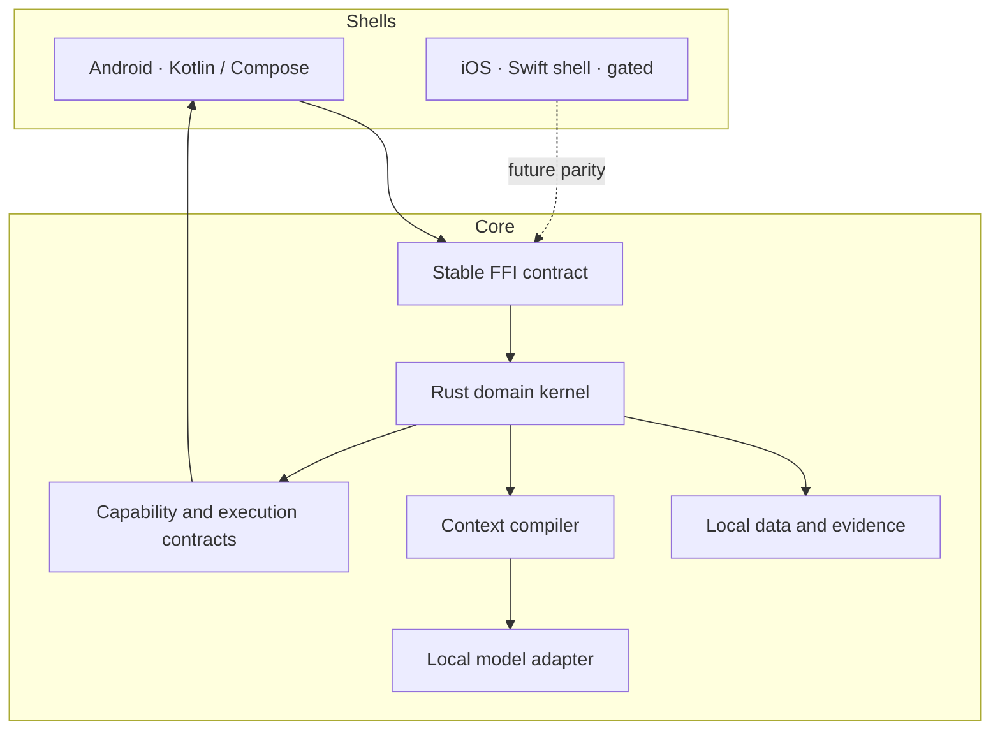

# Locco

**A local-first, mobile-native intelligence and action environment.**

Locco acquires information from sources you choose, preserves evidence, builds a useful model of people, places, things and events, helps you reason over that model with on-device AI, and exposes capabilities for controlled action. It is not a lead-generation app, a business OS, a chatbot shell, or a port of another project.

Android is the primary delivery surface. Rust is the domain core. iOS is an anticipated second shell behind the same stable core contract. There is no HTML or web UI.

## Product identity

Locco is a personal system for connecting the information and capabilities scattered across the digital world. Its product boundary is defined by the engine and its trust model—not by the first source, workflow, or repository that contributed an idea.

- **Acquire:** public web pages, user-visible browser sessions, Android share/import, files, notifications, supported app signals, APIs where available, and manual capture.
- **Understand:** preserve source evidence, extract structured observations, resolve entities, connect relationships, search, compare, and detect patterns.
- **Reason:** use deterministic code first and local AI for bounded semantic work.
- **Act:** invoke explicit capabilities through visible, permissioned, reviewable workflows; verify outcomes.
- **Work:** expose the system through a native workspace that can evolve without changing the domain model.

## Delivery map

| Phase | Outcome | Gate |
|---|---|---|
| 0 — Foundation | Product, architecture, security, agents, skills, CI, empty native shells | Docs reviewed; Rust ABI builds; placeholder APK assembles |
| 1 — Local kernel | Local database, evidence ledger, entity graph, migrations, export/restore | Deterministic tests; data integrity tests |
| 2 — Acquisition | Source contracts, import/share capture, visible browser capture, source provenance | Hostile-input and adapter contract tests |
| 3 — Local intelligence | Model adapter, compact context assembler, retrieval, evaluation harness | Device latency/memory and quality budgets met |
| 4 — Workspace | Native navigation, search, entity/evidence views, review queue | Accessibility and adaptive-layout acceptance |
| 5 — Capabilities | Workflow plans, approvals, execution adapters, verification | Threat review and end-to-end proof per capability |
| 6 — Expansion | Additional sources, model/runtime swaps, iOS shell | Contract parity; no core rewrite |

## Quickstart

```bash
./scripts/verify-foundation.sh
./scripts/build-android-debug.sh
./scripts/build-rust-android.sh
```

See [local development](docs/operations/local-development.md) for prerequisites and exact commands.

## System shape



## Repository map

- `.agent/` — agent roles, authority, routing and repeatable skills.
- `docs/product/` — vision, users, scope and phase acceptance.
- `docs/architecture/` — system contracts, data model, FFI and diagrams.
- `docs/decisions/` — binding ADRs and reversal costs.
- `docs/security/` — threat model, secrets, signing and supply chain.
- `docs/operations/` — phase ingestion, release and local workflows.
- `docs/brainstorm/` — source archive and structured synthesis.
- `core/` — Rust workspace and stable C ABI scaffold.
- `android/` — native Android shell and JNI loading scaffold.
- `ios/` — documented, gated Swift bridge scaffold.
- `incoming/` — untrusted phase ZIP drop zone; never extract manually into the working tree.
- `.github/workflows/` — permanent validation and delivery workflows.

## Foundation status

This repository begins with the foundation only. Placeholder native shells are not product features. A green compile proves wiring, not product readiness. Phase 1 product logic is blocked until the foundation acceptance record is complete.

**Authority:** `PRINCIPLES.md`, `AGENTS.md`, `docs/architecture/`, and accepted ADRs govern future work. When documents conflict, follow the precedence in `CONTRIBUTING.md` and raise an ADR rather than silently improvising.

## Cost posture

Personal-use, zero-budget baseline. No paid API, hosted backend, subscription, cloud model, or proprietary map SDK is mandatory. Optional external services require an explicit ADR and must have a local/manual fallback. Scraping and source access remain subject to authorization, terms, rate limits, privacy law and technical controls; Locco does not bypass authentication, CAPTCHAs, paywalls or anti-bot controls.
