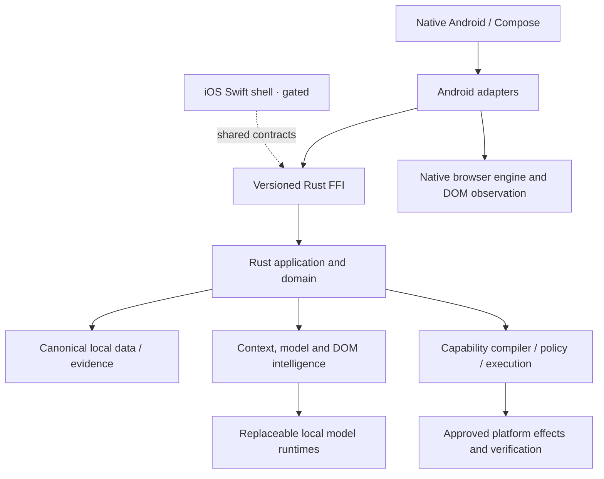

# Locco

**A local-first, mobile-native intelligence and action environment.**

Locco connects information and capabilities fragmented across websites, apps, files, messages, maps, devices and workflows. It preserves evidence and provenance, builds a navigable model of entities and relationships, supports bounded on-device reasoning, and composes controlled actions from reusable capabilities.

Locco's UI is native Android. It includes a **first-class, human-usable browser** for ordinary websites as well as structured DOM inspection and intelligence. This does not create an HTML/web interface for Locco itself. Android is primary; Rust owns the domain core; iOS is anticipated behind the same contracts and remains gated.

## Product loop

Acquire → preserve → understand → connect → reason → decide → act → verify → learn.

## Delivery roadmap

| Phase | Outcome | Gate |
|---|---|---|
| 0 — Foundation and architecture assurance | Product definition, accepted architecture, governance, reproducible Rust/Android build, security and release pipeline | Independent architecture/security/QA acceptance; 3 Android ABIs and APK verified; device evidence recorded |
| 1 — Local kernel and durable data | Canonical storage, stable IDs, evidence/provenance, entities, claims, relationships, events, search and recovery | Migration, integrity, offline, backup/restore and data-continuity tests |
| 2 — Acquisition and native browser | Full native browser, account/session profiles, authorized source adapters, DOM observation and Inspect/Select | LOC-0005 login/session acceptance; browser usable without AI; capture provenance and profile isolation verified |
| 3 — Model ecosystem and local inference | Rich Model Hub, catalogue sources, artifact manifests, runtime adapters, device-fit tests, benchmarks and context/retrieval | Integrity, load, compatibility, quality, RAM/thermal and cancellation evidence on target devices |
| 4 — Semantic intelligence and Capability Compiler | DOM Stitching, evidence-backed schemas, TaskSpec, RequirementGraph, generic typed capability assembly | Unfamiliar tasks pass without use-case-specific planner branches; generated structures and locators are validated |
| 5 — Controlled execution and integrated workspace | Durable async execution, approvals, pause/cancel/takeover, verification and complete native workspace | Device-tested actions, exact approval binding, crash recovery and postcondition evidence |
| 6 — Product hardening and expansion | Security, offline recovery, performance, accessibility, release continuity, additional modalities and gated iOS | Independent release/security acceptance, signed artifact, upgrade/restore and device verification |

The roadmap is a dependency map, not a progress percentage. Individual deliveries and their evidence are tracked through permanent `LOC-####` issues. See [the delivery lifecycle](docs/operations/delivery-lifecycle.md).

## Quickstart

```bash
./scripts/verify-foundation.sh
./scripts/build-android-debug.sh
```

## System



## Repository map

- `.agent/`: role prompts, routing and skills.
- `docs/product/`: vision, users, scope and roadmap.
- `docs/architecture/`: system contracts, model ecosystem, browser/DOM, compiler and UX.
- `docs/decisions/`: append-only ADR history.
- `docs/operations/`: delivery lifecycle, phase and release procedures.
- `docs/security/`: threat, secrets, signing and supply-chain policy.
- `core/`: Rust workspace.
- `android/`: native Android shell and platform adapters.
- `ios/`: gated bridge plan.
- `incoming/`: reserved for explicitly authorized external inputs; not part of normal development.
- `.github/workflows/`: validation and delivery workflows.

## Development workflow

Direct GitHub branches, commits, pull requests and Actions are the canonical internal workflow under ADR-0016. ZIP uploads are not required for phase delivery. See [the phase delivery protocol](docs/operations/phase-protocol.md).

## Authority

The founding mission, product vision/scope, accepted ADRs and security doctrine govern future work. The roadmap shows dependency order; LOC issues record delivery truth. A green compile proves wiring, not product readiness.

## Cost and access

Personal use, zero-budget baseline. No paid API, hosted backend, subscription or cloud model is mandatory. Optional external providers require user configuration and consent. Scraping and acquisition remain subject to authorization, terms, privacy and rate limits; no bypass of authentication, CAPTCHA, paywalls or anti-bot controls.
