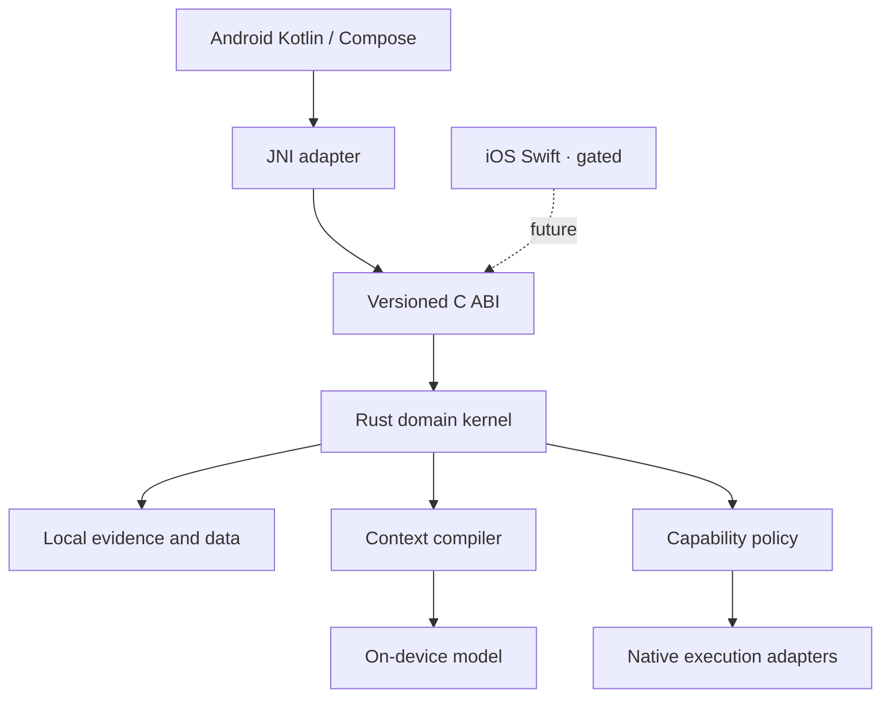

# Locco

**A local-first, mobile-native intelligence and action environment.**

A defining ambition is to make Android more observable and composable: capture inspectable evidence from selected apps, understand supported activity locally, connect it to people, places and things, and provide safe, verified ways to hand off or interact. See [Android App Observation and Interaction](docs/architecture/android-app-observation.md).

Locco acquires information from sources you choose, preserves evidence, builds a useful model of people, places, things and events, supports on-device reasoning, and enables controlled actions. It is not a lead-generation app, business OS, chatbot shell or port of another project.

Android is primary. Rust is the domain core. iOS is anticipated behind the same contract. There is no HTML and no web UI.

## Product loop
Acquire → preserve → understand → connect → reason → decide → act → verify → learn.

## Product contract

The complete product definition, evidence-inspection contract, source boundaries, native browser/DOM requirements, Model Hub, general capability system and definition of done are consolidated in [docs/product/locco-product-contract.md](docs/product/locco-product-contract.md).

## Brainstorm archive

The archive's provenance and known gaps are recorded in [docs/brainstorm/recovery-notes.md](docs/brainstorm/recovery-notes.md). The founding brief is a reconstructed transcription, not a byte-for-byte export of the original brainstorming conversation.

## Delivery map
| Phase | Outcome | Gate |
|---|---|---|
| 0 Foundation | Product, architecture, agents, security, CI, empty shells | Rust 3 ABIs + placeholder APK |
| 1 Local kernel | DB, evidence ledger, entity graph, migrations, export | deterministic and integrity tests |
| 2 Acquisition + Android Observation | inspectable notification evidence, visible-UI observation, source capability registry and native capture/import | real background signal → source evidence → clickable inspector, provenance, revocation and reliability tests |
| 3 Local intelligence | on-device runtime, context compiler, retrieval | device latency/RAM and golden set |
| 4 Workspace | native search, entity/evidence views, review | accessibility and state restoration |
| 5 Capabilities | approvals, execution, verification | threat review and end-to-end proof |
| 6 Expansion | more sources and iOS shell | contract parity |

## Foundation archive

The complete level-zero source snapshot is available at [`incoming/foundation.zip`](incoming/foundation.zip).

## Quickstart
```bash
./scripts/verify-foundation.sh
./scripts/build-rust-android.sh
./scripts/build-android-debug.sh
```

## System


## Repository map
- `.agent/`: agent roles, routing and skills.
- `docs/product/`: vision, users, scope, roadmap.
- `docs/architecture/`: system, data, FFI, AI and UX.
- `docs/decisions/`: ADR history.
- `docs/security/`: threat, secrets, signing, supply chain.
- `docs/operations/`: phase, release, local build.
- `core/`: Rust workspace.
- `android/`: native Android shell.
- `ios/`: gated bridge plan.
- `incoming/`: untrusted phase ZIP drop zone.
- `.github/workflows/`: permanent validation and delivery.

## Authority
PRINCIPLES.md, accepted ADRs, product scope and security doctrine govern future work. A green compile proves wiring, not product readiness.

## Cost and access
Personal use, zero-budget baseline. No paid API, hosted backend, subscription or cloud model is mandatory. Scraping remains subject to authorization, terms, privacy and rate limits; no bypass of authentication, CAPTCHAs, paywalls or anti-bot controls.