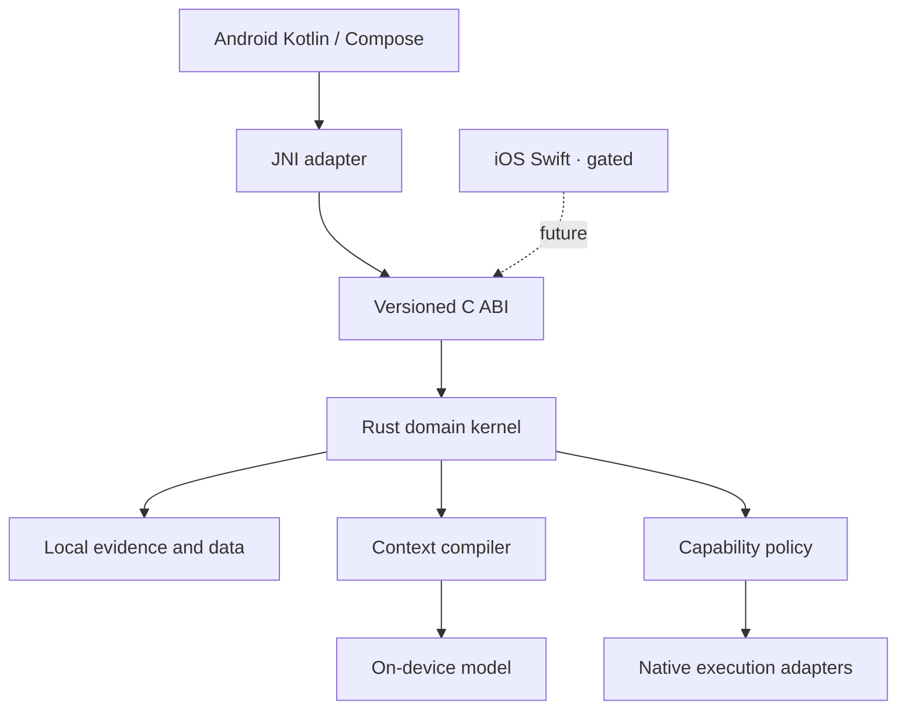

# Locco

**A local-first, mobile-native intelligence and action environment.**

Locco connects information and capabilities fragmented across websites, apps, files, messages, maps, devices and workflows. It captures information with provenance, builds a navigable model of entities and relationships, supports compact on-device reasoning, and enables controlled actions. It is not defined by a single vertical or use case.

Android is primary. Rust is the domain core. iOS is anticipated behind the same contract. There is no HTML and no web UI.

## Product loop
Acquire → preserve → understand → connect → reason → decide → act → verify → learn. The user remains the authority.

## Operating authority — read before work

**[GOVERNANCE.md](GOVERNANCE.md) is the binding product and engineering constitution.** It prevents loss of user feedback, silent scope changes, replacement applications, destructive resets and unsupported completion claims.

- [Agent operating contract](AGENTS.md)
- [Principles](PRINCIPLES.md)
- [Governance procedures](docs/governance/README.md)
- [Feedback register](docs/product/feedback-register.md)
- [Product vision](docs/product/vision.md) · [Scope](docs/product/scope.md) · [Roadmap](docs/product/roadmap.md)
- [ADRs](docs/decisions/README.md)

## The continuity rule

Locco is one evolving application in this repository. New bug reports repair it. New feature requests extend it. Neither creates a replacement app, parallel scaffold, new package identity or clean-slate rewrite. Previously reported bugs and accepted capabilities remain visible until their own linked acceptance evidence proves they are resolved.

Every report is recorded in GitHub Issues as `LOC-####`. Every implementation PR links its feedback, records the baseline, identifies existing behavior to preserve, proves regression coverage, documents data/upgrade safety and reports actual verification evidence.

## Delivery map

| Phase | Outcome | Gate |
|---|---|---|
| 0 Foundation | Product authority, architecture, security, agent system, CI, empty native shells | Verified Rust ABIs + placeholder APK + required controls |
| 1 Local kernel | DB, migrations, IDs, evidence ledger, entity graph, events, export/restore | Deterministic integrity, migration and round-trip tests |
| 2 Acquisition | Native capture/import and source adapters | Provenance, dedupe, cancellation and hostile-input tests |
| 3 Local intelligence | On-device runtime, context compiler and retrieval | Measured latency/RAM, golden set and deterministic fallback |
| 4 Workspace | Native search, entity/evidence views and review | Accessibility, lifecycle and state restoration |
| 5 Capabilities | Typed plans, policy, approvals, execution and verification | Threat review and end-to-end postcondition proof |
| 6 Expansion/iOS | Additional sources and iOS shell | Contract parity, migration plan and product approval |

A phase is a delivery boundary, never a reset of the app, backlog, data or product identity.

## Product loop architecture



## Repository map

- `GOVERNANCE.md`: binding product/engineering constitution.
- `.agent/`: agent roles, routing and skills.
- `docs/governance/`: feedback, change-control and app-continuity procedures.
- `docs/product/`: vision, users, scope, roadmap and feedback register.
- `docs/architecture/`: system, data, FFI, AI and UX contracts.
- `docs/decisions/`: ADR history.
- `docs/security/`: threat, secrets, signing and supply chain.
- `docs/operations/`: setup, phases, release, local build and status.
- `core/`: Rust workspace.
- `android/`: native Android shell.
- `ios/`: gated bridge plan.
- `.github/workflows/`: build, security, release and change-contract gates.

## Development

Use focused GitHub branches, commits, PRs and Actions directly in this repository. ZIP intake remains only for exceptional external contributions; it is not an internal development handoff.

## Quickstart

```bash
./scripts/verify-foundation.sh
./scripts/build-rust-android.sh
./scripts/build-android-debug.sh
```

A green compile proves wiring, not product readiness, regression safety, upgrade compatibility or physical-device behavior.

## Cost, privacy and access

Personal use, zero-budget baseline. No paid API, hosted backend, subscription or cloud model is mandatory. Scraping remains subject to authorization, terms, privacy and rate limits; no bypass of authentication, CAPTCHAs, paywalls or anti-bot controls.
